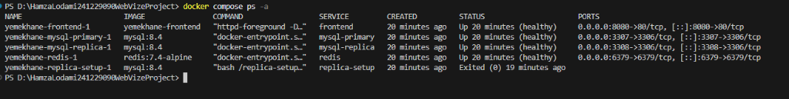
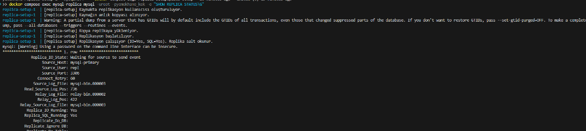
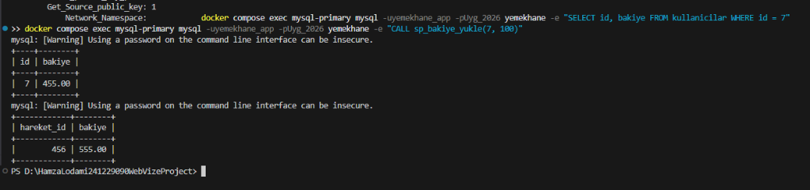
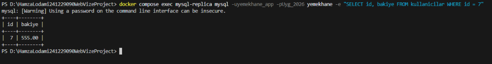
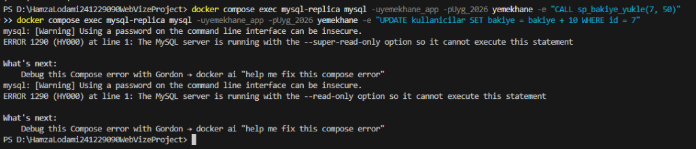
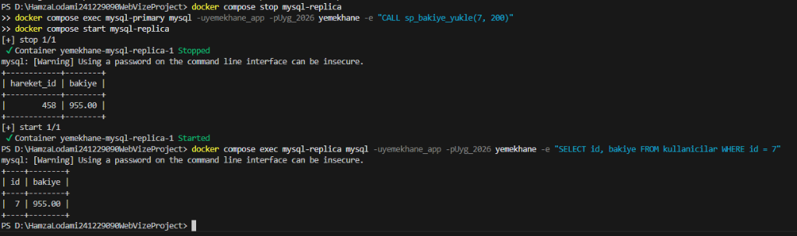

# Aşama 1 – Altyapı (Docker ve MySQL Replication) Raporu

Bu raporda Yemekhane Otomasyonu projesinin Docker Compose tabanlı başlangıç altyapısının ayağa kaldırılması, servis sağlık kontrollerinin doğrulanması ve MySQL Primary–Replica (kaynak–replika) GTID replikasyon testleri belgelenmiştir.

---

## Servis Mimarisi Özeti (`docker-compose.yml`)

| Servis | İmaj / Kaynak | Port (Yerel → Container) | Görevi |
|---|---|---|---|
| `mysql-primary` | `mysql:8.4` (`server-id=1`) | `3307 → 3306` | Yazma (kaynak) veritabanı. GTID ve binary log (`mysql-bin`) açıktır. İlk açılışta `01_sema.sql` ve `02_ornek_veri.sql` dosyalarını otomatik yükler. |
| `mysql-replica` | `mysql:8.4` (`server-id=2`) | `3308 → 3306` | Okuma (salt okunur replika) veritabanı. Relay log (`relay-bin`) ile kaynaktaki değişiklikleri eşzamansız olarak uygular. |
| `replica-setup` | `mysql:8.4` | — | Tek seferlik kurulum container'ı (`db/replica-setup.sh`). Replikasyon kullanıcısını oluşturur, anlık kopyayı replikaya yükler, GTID otomatik konumlandırma ile replikasyonu başlatır, replikayı kalıcı olarak `read_only` ve `super_read_only` yapar ve `Exited (0)` kodu ile sonlanır. |
| `redis` | `redis:7.4-alpine` | `6379 → 6379` | Menü önbelleği ve oturum deposu (AOF kalıcılığı `--appendonly yes` açıktır). |
| `frontend` | `./apache` (`httpd:2.4-alpine`) | `8080 → 80` | Statik HTML/CSS/JS dosyalarını sunar ve uygulama isteklerini reverse proxy ile uygulama servisine iletir. |

---

## Test 1 – Docker Servislerinin Durumu

### Kullanılan Komut
```powershell
docker compose up -d
docker compose ps -a
```

### Komut Çıktısı
```text
NAME                        IMAGE                COMMAND                  SERVICE         CREATED          STATUS                      PORTS
yemekhane-frontend-1        yemekhane-frontend   "httpd-foreground -D…"   frontend        20 minutes ago   Up 20 minutes (healthy)     0.0.0.0:8080->80/tcp, [::]:8080->80/tcp
yemekhane-mysql-primary-1   mysql:8.4            "docker-entrypoint.s…"   mysql-primary   20 minutes ago   Up 20 minutes (healthy)     0.0.0.0:3307->3306/tcp, [::]:3307->3306/tcp
yemekhane-mysql-replica-1   mysql:8.4            "docker-entrypoint.s…"   mysql-replica   20 minutes ago   Up 20 minutes (healthy)     0.0.0.0:3308->3306/tcp, [::]:3308->3306/tcp
yemekhane-redis-1           redis:7.4-alpine     "docker-entrypoint.s…"   redis           20 minutes ago   Up 20 minutes (healthy)     0.0.0.0:6379->6379/tcp, [::]:6379->6379/tcp
yemekhane-replica-setup-1   mysql:8.4            "bash /replica-setup…"   replica-setup   20 minutes ago   Exited (0) 19 minutes ago
```

### Ekran Görüntüsü


### Açıklama
`docker compose up -d` komutu ile tüm altyapı tek seferde başlatılmıştır. `frontend`, `mysql-primary`, `mysql-replica` ve `redis` servislerinin tamamı `Up (healthy)` durumundadır. Tek seferlik kurulum betiğini çalıştıran `replica-setup` servisi ise görevini hatasız tamamlayarak `Exited (0)` durumunda sonlanmıştır. Ayrıca `docker compose exec redis redis-cli ping` komutu ile Redis'in `PONG` yanıtı verdiği doğrulanmıştır.

---

## Test 2 – Replica Kurulumunun ve Replikasyon Durumunun Doğrulanması

### Kullanılan Komutlar
```powershell
docker compose logs replica-setup
docker compose exec mysql-replica mysql -uroot -pyemekhane_kok -e "SHOW REPLICA STATUS\G"
```

### Komut Çıktısı
```text
replica-setup-1  | [replica-setup] Kaynakta replikasyon kullanıcısı oluşturuluyor.
replica-setup-1  | [replica-setup] Kaynağın anlık kopyası alınıyor.
replica-setup-1  | [replica-setup] Kopya replikaya yükleniyor.
replica-setup-1  | [replica-setup] Replikasyon başlatılıyor.
replica-setup-1  | [replica-setup] Replikasyon çalışıyor (IO=Yes, SQL=Yes). Replika salt okunur.

*************************** 1. row ***************************
             Replica_IO_State: Waiting for source to send event
                  Source_Host: mysql-primary
                  Source_User: repl
                  Source_Port: 3306
           Replica_IO_Running: Yes
          Replica_SQL_Running: Yes
```

### Ekran Görüntüsü


### Açıklama
`replica-setup` günlükleri kaynak veritabanının GTID bilgisiyle anlık kopyasının alınıp replikaya yüklendiğini ve replikanın salt okunur yapıldığını göstermektedir. `SHOW REPLICA STATUS\G` çıktısında `Source_Host: mysql-primary`, `Replica_IO_Running: Yes` ve `Replica_SQL_Running: Yes` değerleri replikasyonun aktif ve sağlıklı çalıştığını kanıtlamaktadır.

---

## Test 3 – Primary Üzerinde Bakiye Yükleme İşlemi

### Kullanılan Komutlar
```powershell
docker compose exec mysql-primary mysql -uyemekhane_app -pUyg_2026 yemekhane -e "SELECT id, bakiye FROM kullanicilar WHERE id = 7"
docker compose exec mysql-primary mysql -uyemekhane_app -pUyg_2026 yemekhane -e "CALL sp_bakiye_yukle(7, 100)"
```

### Komut Çıktısı
```text
+----+--------+
| id | bakiye |
+----+--------+
|  7 | 455.00 |
+----+--------+

+------------+--------+
| hareket_id | bakiye |
+------------+--------+
|        456 | 555.00 |
+------------+--------+
```

### Ekran Görüntüsü


### Açıklama
`id = 7` numaralı kullanıcı için yazma veritabanı (`mysql-primary`) üzerinde `sp_bakiye_yukle(7, 100)` yordamı çağrılmıştır. Kullanıcının bakiyesi `455.00 TL`'den `555.00 TL`'ye yükselmiş ve `bakiye_hareketleri` tablosuna `456` numaralı hareket kaydı eklenmiştir.

---

## Test 4 – Değişikliğin Replica Üzerinde Görünmesi

### Kullanılan Komut
```powershell
docker compose exec mysql-replica mysql -uyemekhane_app -pUyg_2026 yemekhane -e "SELECT id, bakiye FROM kullanicilar WHERE id = 7"
```

### Komut Çıktısı
```text
+----+--------+
| id | bakiye |
+----+--------+
|  7 | 555.00 |
+----+--------+
```

### Ekran Görüntüsü


### Açıklama
`mysql-primary` üzerinde yapılan `+100 TL` bakiye yükleme işlemi binary log ve GTID replikasyonu üzerinden `mysql-replica` sunucusuna otomatik olarak aktarılmış ve `SELECT` sorgusunda güncel bakiye (`555.00 TL`) replika üzerinde doğrulanmıştır.

---

## Test 5 – Replica Üzerinde Read-Only Hatasının Doğrulanması

### Kullanılan Komutlar
```powershell
docker compose exec mysql-replica mysql -uyemekhane_app -pUyg_2026 yemekhane -e "CALL sp_bakiye_yukle(7, 50)"
docker compose exec mysql-replica mysql -uyemekhane_app -pUyg_2026 yemekhane -e "UPDATE kullanicilar SET bakiye = bakiye + 10 WHERE id = 7"
```

### Komut Çıktısı
```text
ERROR 1290 (HY000) at line 1: The MySQL server is running with the --super-read-only option so it cannot execute this statement
ERROR 1290 (HY000) at line 1: The MySQL server is running with the --read-only option so it cannot execute this statement
```

### Ekran Görüntüsü


### Açıklama
`replica-setup.sh` betiği replikayı `SET PERSIST read_only = ON` ve `SET PERSIST super_read_only = ON` ile kalıcı olarak salt okunur hale getirmiştir. Bu sayede replika üzerinde hem `sp_bakiye_yukle` yordamı çağrısı (`--super-read-only`) hem de doğrudan `UPDATE` denemesi (`--read-only`) `ERROR 1290 (HY000)` hatasıyla reddedilmiştir. Böylece replikasyon tutarlılığı korunmaktadır.

---

## Test 6 – Replica Durdurulup Başlatıldığında Aradaki Değişikliklerin Yakalanması

### Kullanılan Komutlar
```powershell
docker compose stop mysql-replica
docker compose exec mysql-primary mysql -uyemekhane_app -pUyg_2026 yemekhane -e "CALL sp_bakiye_yukle(7, 200)"
docker compose start mysql-replica
docker compose exec mysql-replica mysql -uyemekhane_app -pUyg_2026 yemekhane -e "SELECT id, bakiye FROM kullanicilar WHERE id = 7"
```

### Komut Çıktısı
```text
[+] stop 1/1
 ✔ Container yemekhane-mysql-replica-1 Stopped
+------------+--------+
| hareket_id | bakiye |
+------------+--------+
|        458 | 955.00 |
+------------+--------+
[+] start 1/1
 ✔ Container yemekhane-mysql-replica-1 Started
+----+--------+
| id | bakiye |
+----+--------+
|  7 | 955.00 |
+----+--------+
```

### Ekran Görüntüsü


### Açıklama
`mysql-replica` container'ı durdurulmuşken `mysql-primary` üzerinde `id = 7` kullanıcısına `+200 TL` yüklenerek bakiye `955.00 TL`'ye çıkarılmıştır (`hareket_id = 458`). Ardından `mysql-replica` yeniden başlatıldığında GTID otomatik konumlandırma (`SOURCE_AUTO_POSITION = 1`) sayesinde kapalı olduğu sürede oluşan eksik işlemi kaynaktan otomatik olarak çekmiş ve güncel `955.00 TL` bakiyesini göstermiştir.
