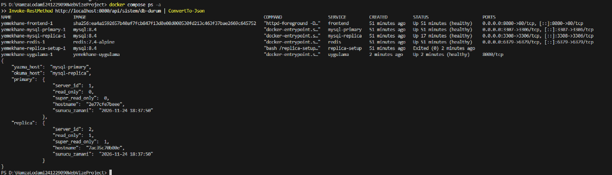
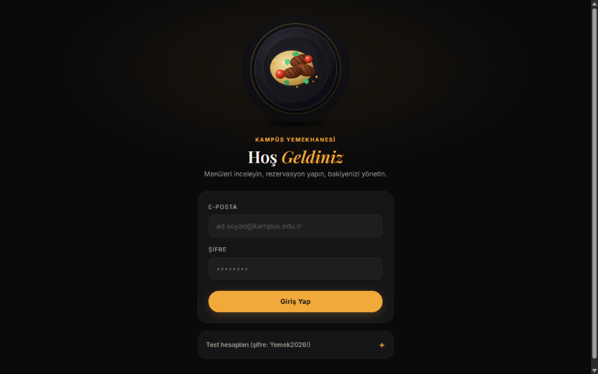
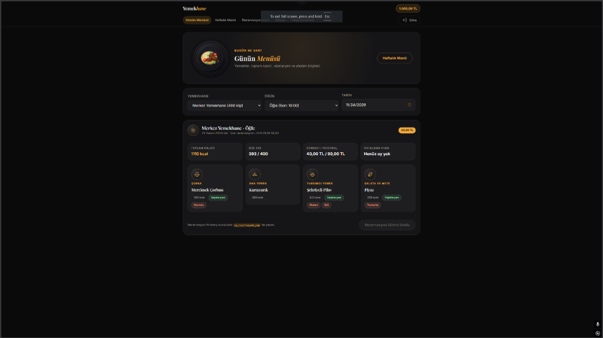
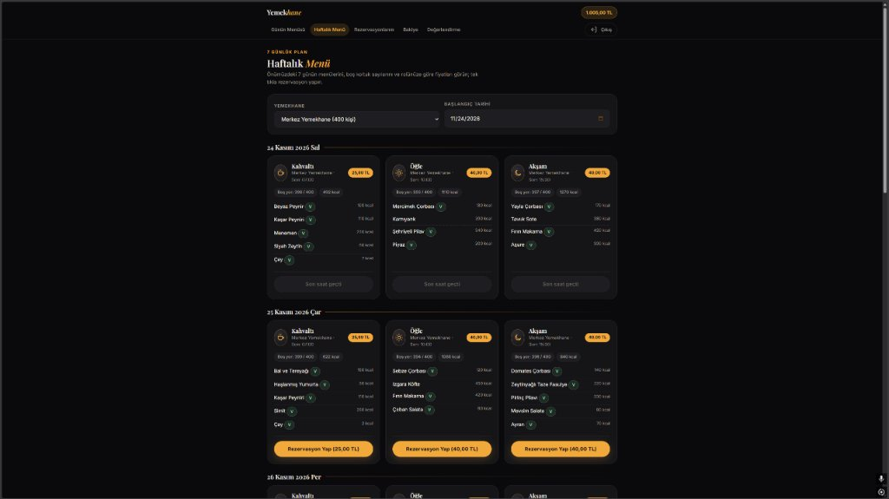
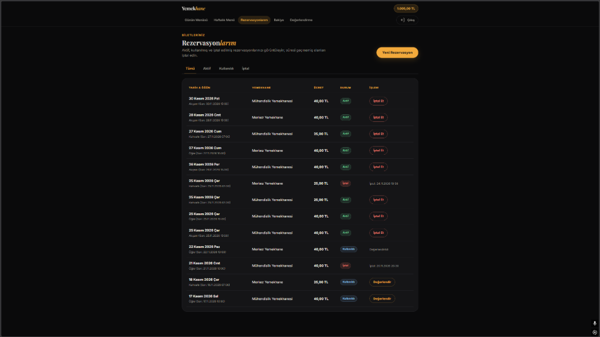
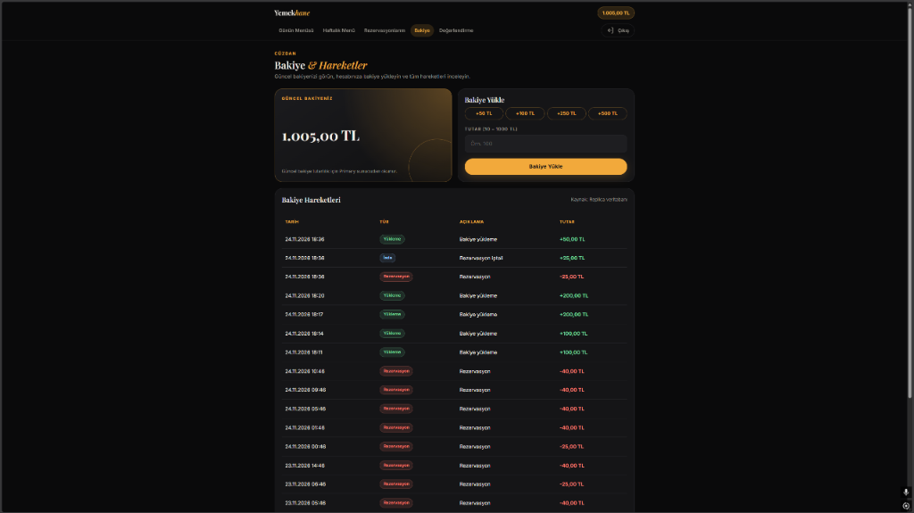
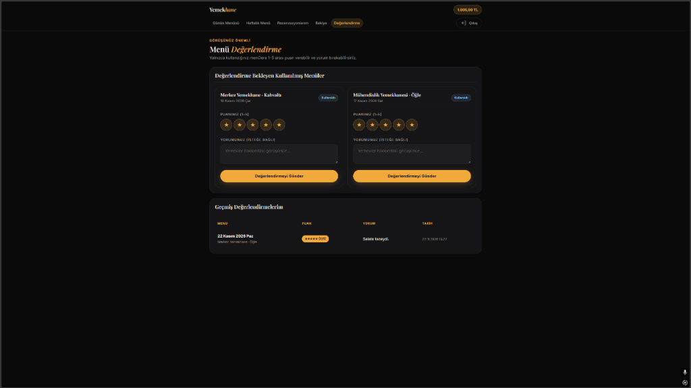
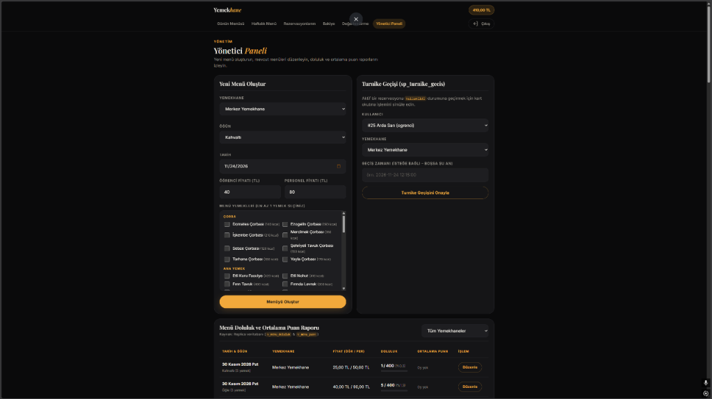
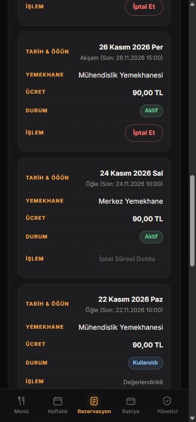

# Aşama 2 – Uygulama ve Arayüz Raporu

## 1. Seçilen Mimari ve Teknoloji Yığını

- **Seçilen Mimari:** **Web API + Arayüz (Frontend)**
- **Backend Teknolojisi:** **Node.js 22 + Express 4** (`uygulama/` servisi, container içi `8000` portu)
- **Arayüz Teknolojisi:** Saf **HTML5 + CSS3 + Vanilla JavaScript (`fetch`)** (React veya benzeri bir frontend çerçevesi kullanılmamıştır; Apache 2.4 `-D WEBAPI` modunda `frontend/` statik dosyalarını sunar ve `/api/...` isteklerini `http://uygulama:8000/api/...` adresine yönlendirir).
- **Veritabanı Sürücüsü & Güvenlik:** `mysql2/promise` (`utf8mb4`, `+03:00` saat dilimi), `bcryptjs` (şifre doğrulama), `cookie-parser` (`HttpOnly` oturum çerezi).

### Katmanlı Mimari Yapısı (`uygulama/src/`)

| Katman | Klasör | Sorumluluğu |
|---|---|---|
| **Route** | `src/routes/` | HTTP uç noktalarını tanımlar ve `oturumZorunlu` / `rolZorunlu('yonetici')` ara yazılımlarını uygular. |
| **Controller** | `src/controllers/` | Yalnızca HTTP istek parametrelerini/gövdesini okur, Service katmanını çağırır ve JSON yanıt döner. SQL içermez. |
| **Service** | `src/services/` | İş mantığını yürütür (bcrypt doğrulama, rol bazlı fiyatlandırma, toplam kalori hesabı, yalnızca `kullanildi` menülerin değerlendirilmesi, yazma sonrası Primary bakiye okuma). |
| **Repository** | `src/repositories/` | Tüm SQL sorgularını, View okumalarını (`v_menu_detay`, `v_menu_doluluk`, `v_menu_puan`) ve Stored Procedure çağrılarını (`sp_rezervasyon_yap`, `sp_rezervasyon_iptal`, `sp_bakiye_yukle`, `sp_turnike_gecis`) yönetir. |
| **Config / Middleware** | `src/config/db.js`, `src/middleware/` | `primaryPool` (yazma) ve `replicaPool` (okuma) havuzlarını ayırır; `SQLSTATE 45000` (hata kodu `1644`) yordam hatalarını Türkçe mesajıyla arayüze iletir. |

---

## 2. Bir İsteğin Katmanlar Arası Akışı (Kod Örneği)

Örnek senaryo: **Kullanıcının rezervasyon oluşturması (`POST /api/rezervasyonlar`)**

```text
Tarayıcı (fetch) → Apache (-D WEBAPI) → Route → Controller → Service → Repository → MySQL Primary (sp_rezervasyon_yap) → JSON Yanıt
```

1. **Route (`uygulama/src/routes/rezervasyonRoutes.js`)**
```javascript
router.use(oturumZorunlu);
router.post('/', rezervasyonController.olustur);
```

2. **Controller (`uygulama/src/controllers/rezervasyonController.js`)**
```javascript
async function olustur(req, res, next) {
  try {
    const { menu_id } = req.body || {};
    const sonuc = await rezervasyonService.rezervasyonYap(req.kullanici.id, menu_id);
    return res.status(201).json(sonuc);
  } catch (err) {
    return next(err);
  }
}
```

3. **Service (`uygulama/src/services/rezervasyonService.js`)**
```javascript
async function rezervasyonYap(kullaniciId, menuId) {
  const mId = Number(menuId);
  if (!Number.isInteger(mId) || mId <= 0) {
    throw new UygulamaHatasi(400, 'Geçerli bir menü seçiniz.');
  }

  // Yazma: sp_rezervasyon_yap Primary üzerinde çalışır
  const spSonuc = await rezervasyonRepo.rezervasyonYap(kullaniciId, mId);

  // Replikasyon gecikmesine karşı güncel bakiye doğrudan Primary'den okunur
  const guncelBakiye = await bakiyeRepo.guncelBakiyePrimaryGetir(kullaniciId);

  return {
    mesaj: 'Rezervasyonunuz başarıyla oluşturuldu.',
    rezervasyon_id: spSonuc.rezervasyon_id,
    ucret: Number(spSonuc.ucret),
    bakiye: guncelBakiye !== null ? guncelBakiye : Number(spSonuc.bakiye),
    bakiye_kaynak: 'mysql-primary'
  };
}
```

4. **Repository (`uygulama/src/repositories/rezervasyonRepository.js`)**
```javascript
async function rezervasyonYap(kullaniciId, menuId) {
  const [resultSets] = await primaryPool.query(
    `CALL sp_rezervasyon_yap(?, ?)`,
    [kullaniciId, menuId]
  );
  return resultSets[0][0];
}
```

5. **Merkezi Hata Yakalama (`uygulama/src/middleware/errorMiddleware.js`)**
```javascript
if (err && (err.sqlState === '45000' || err.errno === 1644)) {
  return res.status(400).json({ hata: err.sqlMessage || err.message });
}
```

---

## 3. Okuma/Yazma Ayrımı ve Replikasyon Gecikmesi (Replication Lag)

Sistemde `uygulama/src/config/db.js` dosyasında iki ayrı bağlantı havuzu tanımlıdır:
- **`primaryPool` (`mysql-primary:3306`)**: `sp_rezervasyon_yap`, `sp_rezervasyon_iptal`, `sp_bakiye_yukle`, `sp_turnike_gecis`, menü ekleme/güncelleme, değerlendirme ekleme ve yazma sonrası anlık bakiye okumaları.
- **`replicaPool` (`mysql-replica:3306`)**: Günün menüsü (`v_menu_detay`), haftalık menü (`v_menu_doluluk`, `v_menu_puan`), rezervasyon geçmişi, bakiye hareket listesi ve yönetici doluluk/puan raporları.

### Rezervasyondan Hemen Sonra Bakiyenin Primary'den Okunma Nedeni

MySQL kaynak–replika replikasyonu **eşzamansız (asynchronous)** çalışır. `sp_rezervasyon_yap` yordamı `mysql-primary` üzerinde commit edildiğinde, ilgili değişikliğin binary log'dan `mysql-replica`'nın relay log'una aktarılıp SQL thread tarafından uygulanması arasında kısa bir **replikasyon gecikmesi (replication lag)** oluşabilir. Eğer rezervasyon tamamlandıktan hemen sonraki milisaniyelerde kullanıcının güncel bakiyesi replikadan okunsaydı, replika henüz yeni işlemi uygulamamış olabileceğinden kullanıcıya eski (düşülmemiş) bakiye gösterilebilir ve *"read-your-own-writes"* tutarsızlığı yaşanabilirdi. Bu nedenle rezervasyon, iptal ve bakiye yükleme işlemlerinden hemen sonra gösterilen bakiye doğrudan `mysql-primary` sunucusundan okunmaktadır.

---

## 4. Primary/Replica Bağlantı ve Stored Procedure Doğrulama Testleri

### 4.1 Container Durumu ve Primary/Replica Ayrımı

```powershell
docker compose ps -a
Invoke-RestMethod http://localhost:8080/api/sistem/db-durum | ConvertTo-Json
```

```json
{
  "yazma_host": "mysql-primary",
  "okuma_host": "mysql-replica",
  "primary": { "server_id": 1, "read_only": 0, "super_read_only": 0 },
  "replica": { "server_id": 2, "read_only": 1, "super_read_only": 1 }
}
```



### 4.2 Stored Procedure ve Hata İletimi Gerçek Test Çıktıları

| Test | Uç Nokta & Yordam | Gerçek API Çıktısı |
|---|---|---|
| Rezervasyon oluşturma | `POST /api/rezervasyonlar` (`sp_rezervasyon_yap`) | `{"mesaj":"Rezervasyonunuz başarıyla oluşturuldu.","rezervasyon_id":368,"ucret":25,"bakiye":930,"bakiye_kaynak":"mysql-primary"}` |
| Rezervasyon iptali | `DELETE /api/rezervasyonlar/368` (`sp_rezervasyon_iptal`) | `{"mesaj":"Rezervasyonunuz iptal edildi ve ücret bakiyenize iade edildi.","rezervasyon_id":368,"iade":25,"bakiye":955,"bakiye_kaynak":"mysql-primary"}` |
| Bakiye yükleme | `POST /api/bakiye/yukle` (`sp_bakiye_yukle`) | `{"mesaj":"50.00 TL bakiyenize yüklendi.","hareket_id":461,"bakiye":1005,"bakiye_kaynak":"mysql-primary"}` |
| Yetersiz bakiye hatası (`ayse.demir`, 12,50 TL) | `POST /api/rezervasyonlar` (`SQLSTATE 45000`) | HTTP 400: `{"hata":"Bakiye yetersiz."}` |
| Kullanılmamış menüye değerlendirme engeli | `POST /api/degerlendirmeler` | HTTP 400: `{"hata":"Yalnızca kullandığınız menüleri değerlendirebilirsiniz."}` |

---

## 5. Uygulama Ekran Görüntüleri

### Ekran 1 – Giriş Ekranı (`/`)
E-posta ve şifre girişi, backend'de `bcryptjs` doğrulaması ve `HttpOnly` güvenli oturum çerezi oluşturma.



### Ekran 2 – Günün Menüsü (`/gunun-menusu.html`)
Yemekhane, öğün ve tarih seçimi; `v_menu_detay` üzerinden kategori sırasına göre yemekler, toplam kalori, vejetaryen ve alerjen rozetleri.



### Ekran 3 – Haftalık Menü ve Rezervasyon (`/haftalik-menu.html`)
`v_menu_doluluk` üzerinden boş koltuk sayısı, kullanıcı rolüne göre ücret, son saati geçen öğünlerde pasif (`Son saat geçti`) düğme ve açık öğünlerde tek tıkla rezervasyon.



### Ekran 4 – Rezervasyonlarım (`/rezervasyonlarim.html`)
Aktif, kullanıldı ve iptal sekmeleri; süresi geçmemiş aktif rezervasyonlar için `sp_rezervasyon_iptal` ile iptal ve iade işlemi.



### Ekran 5 – Bakiye ve Hareket Geçmişi (`/bakiye.html`)
Primary'den okunan güncel bakiye kartı, `sp_bakiye_yukle` ile bakiye yükleme formu ve Replica'dan okunan işaretli (`+` / `-`) hareket geçmişi tablosu.



### Ekran 6 – Değerlendirme (`/degerlendirme.html`)
Yalnızca `kullanildi` durumundaki menülere 1–5 yıldız puanlama ve yorum bırakma ekranı ile geçmiş değerlendirmeler listesi.



### Ekran 7 – Yönetici Paneli (`/yonetici.html`)
Sadece `yonetici` rolüne açık menü oluşturma/düzenleme formu, `sp_turnike_gecis` turnike simülatörü ve Replica üzerinden `v_menu_doluluk` + `v_menu_puan` doluluk ve ortalama puan raporu.



### Duyarlı (Responsive) Mobil Görünüm (~400 px)
Yaklaşık 400 px telefon genişliğinde alt gezinme çubuğu, açılır menü çekmecesi ve yatay kaydırmasız kartlara dönüşen tablolar.


