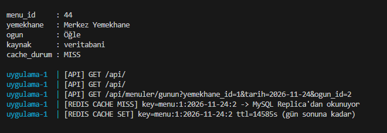
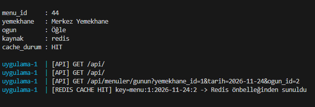
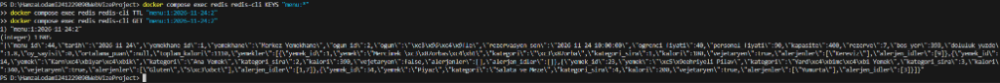
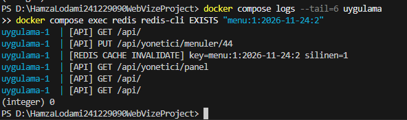
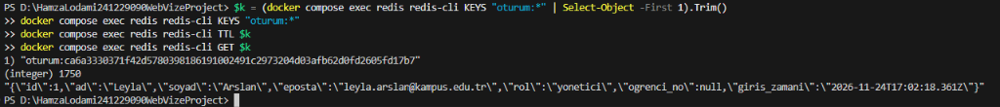
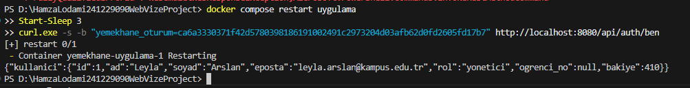

# Aşama 3 – Redis Cache ve Session Raporu

Bu aşamada `redis:7.4-alpine` servisi (`--appendonly yes` kalıcılık açık) `uygulama` servisine `ioredis` istemcisi (`uygulama/src/config/redis.js`) ile bağlanmış ve iki temel amaç için kullanılmıştır:

| Görev | Anahtar Biçimi | Süre (TTL) | Ne Zaman Silinir |
|---|---|---|---|
| **Menü Önbelleği** (`menuCache.js`) | `menu:{yemekhane_id}:{tarih}:{ogun_id}` | İlgili günün sonuna (`23:59:59 +03:00`) kadar | Yönetici o menüyü oluşturduğunda veya güncellediğinde (`DEL`) |
| **Oturum Deposu** (`sessionStore.js`) | `oturum:{token}` | 30 dakika (`1800` saniye), her istekte `EXPIRE` ile yenilenir | Kullanıcı çıkış yaptığında (`DEL`) |

---

## Test 1 – İlk Menü İsteğinin Veritabanından Gelmesi (`CACHE MISS`)

### Kullanılan Komutlar
```powershell
(Invoke-RestMethod "http://localhost:8080/api/menuler/gunun?yemekhane_id=1&tarih=2026-11-24&ogun_id=2").menu | Select-Object menu_id, yemekhane, ogun, kaynak, cache_durum
docker compose logs --tail=5 uygulama
```

### Komut Çıktısı
```text
menu_id     : 44
yemekhane   : Merkez Yemekhane
ogun        : Öğle
kaynak      : veritabani
cache_durum : MISS

uygulama-1  | [API] GET /api/menuler/gunun?yemekhane_id=1&tarih=2026-11-24&ogun_id=2
uygulama-1  | [REDIS CACHE MISS] key=menu:1:2026-11-24:2 -> MySQL Replica'dan okunuyor
uygulama-1  | [REDIS CACHE SET] key=menu:1:2026-11-24:2 ttl=14585s (gün sonuna kadar)
```

### Ekran Görüntüsü


### Açıklama
İlk istekte `menu:1:2026-11-24:2` anahtarı Redis'te bulunmadığı için `CACHE MISS` oluşmuş, veri MySQL Replica üzerinden okunmuş ve ilgili günün sonuna kadar (`ttl=14585s`) Redis'e kaydedilmiştir.

---

## Test 2 – İkinci Menü İsteğinin Redis'ten Gelmesi (`CACHE HIT`)

### Kullanılan Komutlar
```powershell
(Invoke-RestMethod "http://localhost:8080/api/menuler/gunun?yemekhane_id=1&tarih=2026-11-24&ogun_id=2").menu | Select-Object menu_id, yemekhane, ogun, kaynak, cache_durum
docker compose logs --tail=4 uygulama
```

### Komut Çıktısı
```text
menu_id     : 44
yemekhane   : Merkez Yemekhane
ogun        : Öğle
kaynak      : redis
cache_durum : HIT

uygulama-1  | [API] GET /api/menuler/gunun?yemekhane_id=1&tarih=2026-11-24&ogun_id=2
uygulama-1  | [REDIS CACHE HIT] key=menu:1:2026-11-24:2 -> Redis önbelleğinden sunuldu
```

### Ekran Görüntüsü


### Açıklama
Aynı menüye yapılan ikinci istekte MySQL'e hiç sorgu atılmadan doğrudan Redis önbelleğinden yanıt dönülmüş (`kaynak: redis`, `cache_durum: HIT`) ve uygulama günlüğüne `[REDIS CACHE HIT]` kaydedilmiştir.

---

## Test 3 – `redis-cli` ile Menü Önbellek Kaydının Doğrulanması

### Kullanılan Komutlar
```powershell
docker compose exec redis redis-cli KEYS "menu:*"
docker compose exec redis redis-cli TTL "menu:1:2026-11-24:2"
docker compose exec redis redis-cli GET "menu:1:2026-11-24:2"
```

### Komut Çıktısı
```text
1) "menu:1:2026-11-24:2"
(integer) 13875
"{\"menu_id\":44,\"tarih\":\"2026-11-24\",\"yemekhane_id\":1,\"yemekhane\":\"Merkez Yemekhane\",\"ogun_id\":2,...}"
```

### Ekran Görüntüsü


### Açıklama
`redis-cli` ile `menu:1:2026-11-24:2` anahtarının Redis'te JSON formatında tutulduğu ve kalan süresinin (`13875` saniye ≈ gece yarısına kalan süre) doğru ayarlandığı doğrulanmıştır.

---

## Test 4 – Yönetici Menüyü Değiştirdiğinde Eski Önbellek Kaydının Silinmesi

### Kullanılan Komutlar
Yönetici Paneli üzerinden `menu_id = 44` (24 Kasım 2026 · Merkez Yemekhane · Öğle) güncellendikten hemen sonra:
```powershell
docker compose logs --tail=6 uygulama
docker compose exec redis redis-cli EXISTS "menu:1:2026-11-24:2"
```

### Komut Çıktısı
```text
uygulama-1  | [API] PUT /api/yonetici/menuler/44
uygulama-1  | [REDIS CACHE INVALIDATE] key=menu:1:2026-11-24:2 silinen=1
uygulama-1  | [API] GET /api/yonetici/panel
(integer) 0
```

### Ekran Görüntüsü


### Açıklama
Yönetici menüyü kaydettiğinde `yoneticiService.menuGuncelle` önce Primary veritabanını güncellemiş, ardından `menuCache.menuSil(1, '2026-11-24', 2)` ile ilgili Redis anahtarını silmiştir (`silinen=1`, `EXISTS` sonucu `0`). Bir sonraki menü isteği güncel veriyi veritabanından çekip yeniden önbelleğe almaktadır.

---

## Test 5 – Kullanıcı Oturumunun Redis'te Saklanması (`oturum:{token}`)

### Kullanılan Komutlar
```powershell
$k = (docker compose exec redis redis-cli KEYS "oturum:*" | Select-Object -First 1).Trim()
docker compose exec redis redis-cli KEYS "oturum:*"
docker compose exec redis redis-cli TTL $k
docker compose exec redis redis-cli GET $k
```

### Komut Çıktısı
```text
1) "oturum:ca6a3330371f42d5780398186191002491c2973204d03afb62d0fd2605fd17b7"
(integer) 1750
"{\"id\":1,\"ad\":\"Leyla\",\"soyad\":\"Arslan\",\"eposta\":\"leyla.arslan@kampus.edu.tr\",\"rol\":\"yonetici\",\"ogrenci_no\":null,\"giris_zamani\":\"2026-11-24T17:02:18.361Z\"}"
```

### Ekran Görüntüsü


### Açıklama
Kullanıcı giriş yaptığında 32 byte rastgele kriptografik token üretilerek `oturum:{token}` anahtarıyla `1800` saniye (30 dakika) TTL ile Redis'e yazılmaktadır. Her istekte `EXPIRE` ile süre 30 dakikaya yenilenir; çıkış (`/api/auth/cikis`) işleminde ise `DEL` ile silinir.

---

## Test 6 – Uygulama Container'ı Yeniden Başlatıldığında Oturumun Devam Etmesi

### Kullanılan Komutlar
```powershell
docker compose restart uygulama
Start-Sleep 3
curl.exe -s -b "yemekhane_oturum=ca6a3330371f42d5780398186191002491c2973204d03afb62d0fd2605fd17b7" http://localhost:8080/api/auth/ben
```

### Komut Çıktısı
```text
[+] restart 0/1
 - Container yemekhane-uygulama-1 Restarting
{"kullanici":{"id":1,"ad":"Leyla","soyad":"Arslan","eposta":"leyla.arslan@kampus.edu.tr","rol":"yonetici","ogrenci_no":null,"bakiye":410}}
```

### Ekran Görüntüsü


### Açıklama
Oturumlar artık Node.js belleğinde değil harici `redis` container'ında tutulduğu için `docker compose restart uygulama` komutu sonrasında aynı oturum çereziyle yapılan `/api/auth/ben` isteği kullanıcıyı düşürmeden başarıyla yanıt vermeye devam etmiştir.
