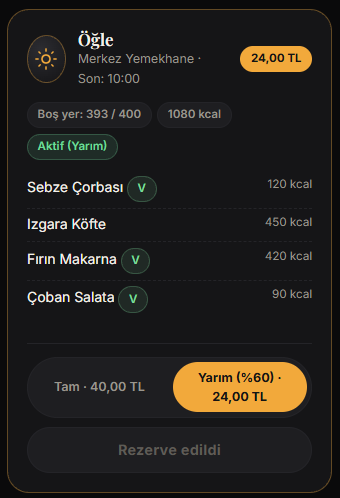
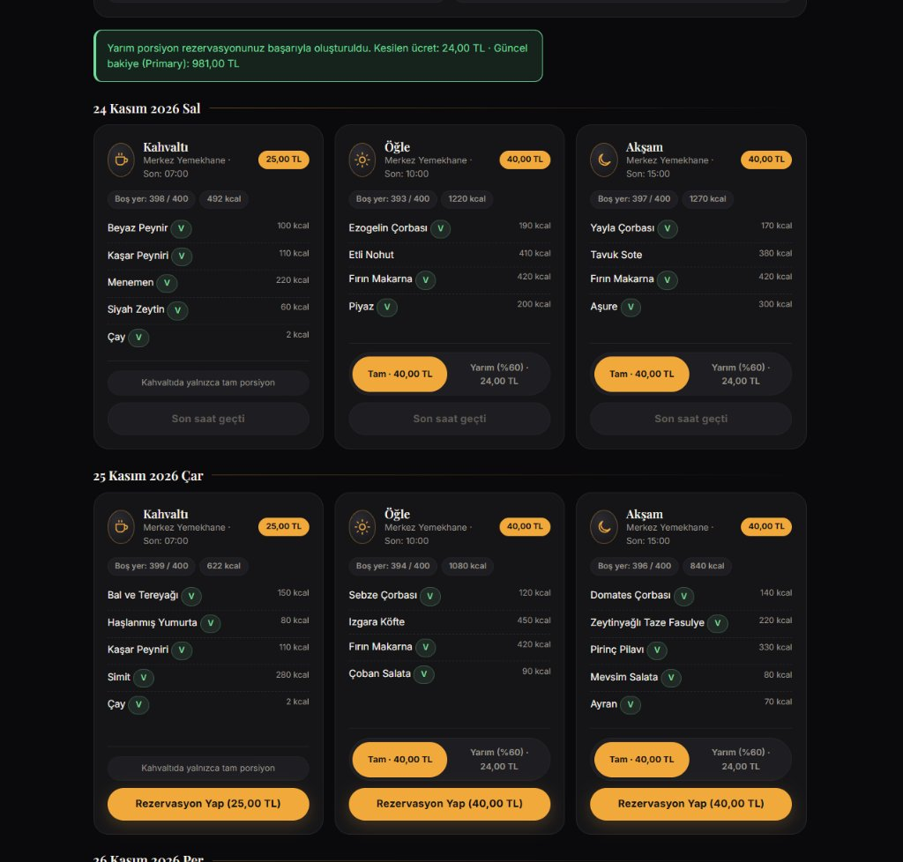
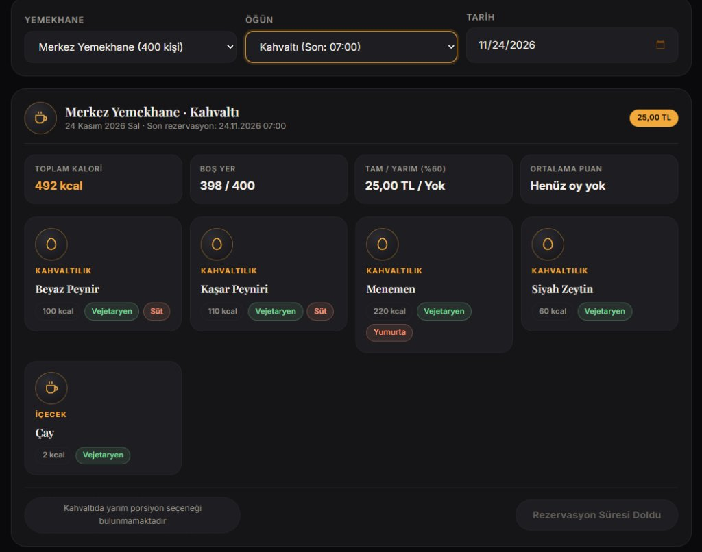
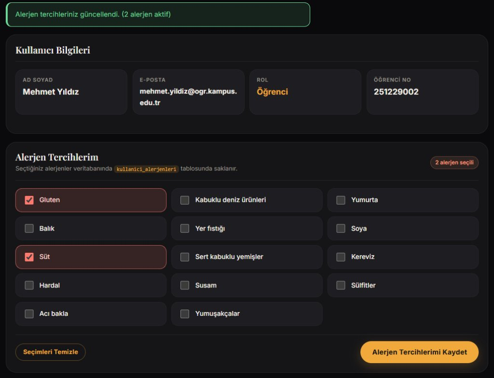
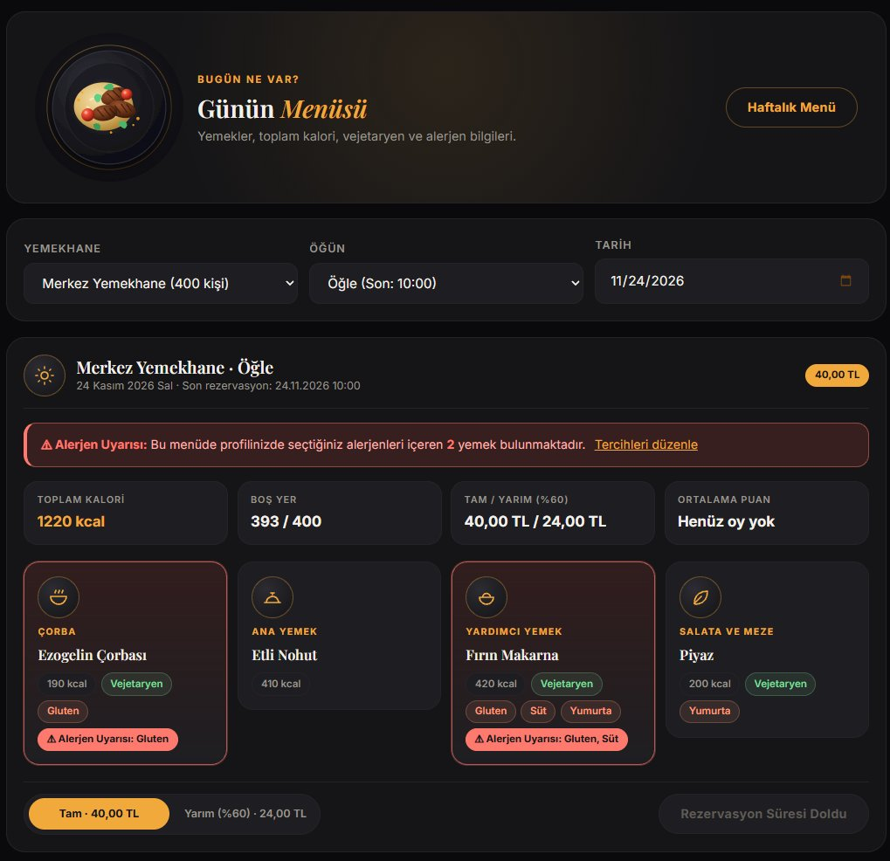
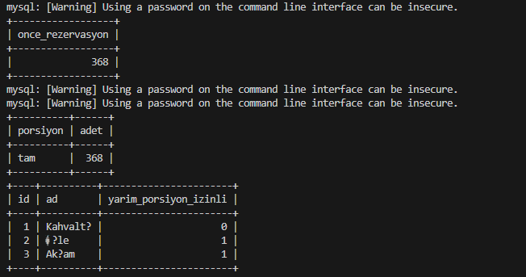
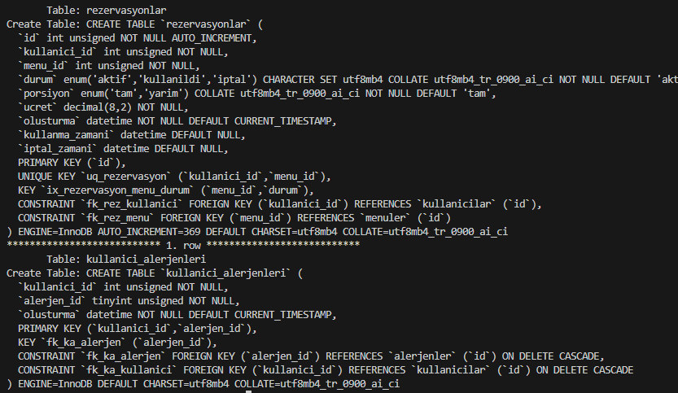
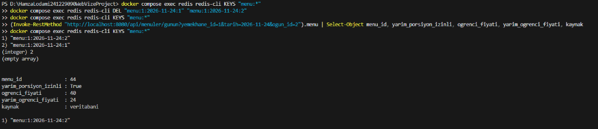

# Aşama 4 – Değişiklik Talebi ve Migration Raporu

Bu aşamada çalışan sisteme mevcut veriler silinmeden ve başlangıç veritabanı sıfırlanmadan tek bir migration dosyası (`db/init/04_degisiklik.sql`) ile iki yeni özellik eklenmiştir:
1. **Yarım Porsiyon:** Öğle ve akşam yemeklerinde tam fiyatın %60'ı üzerinden yarım porsiyon seçimi (kahvaltıda kapalı, eski rezervasyonlar `tam` porsiyon kabul edilir).
2. **Alerjen Uyarısı:** Kullanıcının profilinde seçtiği alerjenlerin (`kullanici_alerjenleri`) menüdeki yemeklerle karşılaştırılıp eşleşen yemeklerde uyarı gösterilmesi (alerjensiz yemeklerde yanlış uyarı üretilmez).

---

## Test 1 – Yarım Porsiyon Seçimi

Öğle ve akşam menülerinde **Tam** ile **Yarım (%60)** seçenekleri sunulmaktadır. Aşağıdaki ekran görüntüsünde 25 Kasım 2026 Çarşamba Öğle menüsü için **Yarım (%60) · 24,00 TL** seçimi ve `Aktif (Yarım)` durumu görülmektedir.



---

## Test 2 – Yarım Porsiyon için %60 Fiyat Hesaplaması

Tam öğrenci ücreti `40,00 TL` olan öğle menüsü için yarım porsiyon rezervasyonu yapıldığında `sp_rezervasyon_yap` yordamı `ROUND(v_tam_ucret * 0.60, 2)` formülüyle tam olarak **`24,00 TL`** kesmiş ve Primary üzerinden güncel bakiyeyi (`981,00 TL`) göstermiştir.



---

## Test 3 – Kahvaltıda Yarım Porsiyon Seçeneğinin Bulunmaması

`ogunler.yarim_porsiyon_izinli` sütunu Kahvaltı için `0` olduğundan, arayüzde kahvaltı öğününde yarım porsiyon seçeneği kapatılmış (`TAM / YARIM (%60): 25,00 TL / Yok`, *"Kahvaltıda yarım porsiyon seçeneği bulunmamaktadır"*) ve doğrudan API'den yarım porsiyon denemesi yapıldığında `sp_rezervasyon_yap` yordamı HTTP 400 `{"hata":"Kahvaltı öğününde yarım porsiyon seçilemez."}` hatasıyla işlemi reddetmiştir.



---

## Test 4 – Profilde Alerjen Seçimi (`/profil.html`)

Kullanıcı profil sayfasından **Gluten** ve **Süt** alerjenlerini seçip kaydettiğinde kayıtlar `PUT /api/profil/alerjenler` üzerinden `mysql-primary` sunucusundaki `kullanici_alerjenleri` tablosuna yazılmakta ve replikasyonla `mysql-replica`'ya aktarılmaktadır.



---

## Test 5 – Menüde Alerjen Uyarısı (Yanlış Uyarı Üretmeden)

Kullanıcının seçtiği **Gluten** ve **Süt** alerjenleri menüdeki yemeklerle karşılaştırılmış;
- **Ezogelin Çorbası** (`Gluten`) ve **Fırın Makarna** (`Gluten, Süt`) kırmızı çerçeve ve `⚠ Alerjen Uyarısı` etiketiyle işaretlenmiştir.
- Alerjen içermeyen **Etli Nohut** ve kullanıcının seçmediği alerjeni (`Yumurta`) içeren **Piyaz** yemeklerinde hiçbir yanlış uyarı üretilmemiştir.



---

## Test 6 – Primary Üzerinde Canlı Migration İşlemi (`04_degisiklik.sql`)

### Kullanılan Komutlar
```powershell
docker compose exec mysql-primary mysql -uyemekhane_app -pUyg_2026 yemekhane -e "SELECT COUNT(*) AS once_rezervasyon FROM rezervasyonlar"
docker compose exec mysql-primary bash -c "mysql --default-character-set=utf8mb4 -uroot -pyemekhane_kok yemekhane < /docker-entrypoint-initdb.d/04_degisiklik.sql"
docker compose exec mysql-primary mysql -uyemekhane_app -pUyg_2026 yemekhane -e "SELECT porsiyon, COUNT(*) AS adet FROM rezervasyonlar GROUP BY porsiyon; SELECT id, ad, yarim_porsiyon_izinli FROM ogunler"
```

### Komut Çıktısı
```text
once_rezervasyon: 368
porsiyon=tam -> adet=368 (tüm eski rezervasyonlar veri kaybı olmadan tam porsiyon kabul edildi)
ogunler -> 1 (Kahvaltı): 0 | 2 (Öğle): 1 | 3 (Akşam): 1
```

### Ekran Görüntüsü


---

## Test 7 – Değişikliklerin Replica'ya Geçmesi (`SHOW CREATE TABLE`)

### Kullanılan Komut
```powershell
docker compose exec mysql-replica mysql -uroot -pyemekhane_kok yemekhane -e "SHOW CREATE TABLE rezervasyonlar\G SHOW CREATE TABLE kullanici_alerjenleri\G"
```

### Ekran Görüntüsü


### Açıklama
Migration yalnızca `mysql-primary` üzerinde çalıştırılmış, DDL ve DML değişiklikleri GTID replikasyonuyla otomatik olarak `mysql-replica`'ya geçmiştir. `SHOW CREATE TABLE` çıktısında hem `rezervasyonlar.porsiyon` sütununun hem de `kullanici_alerjenleri` tablosunun replikada oluştuğu doğrulanmıştır.

---

## Test 8 – Redis Eski Menü Önbellek Kayıtlarının Temizlenmesi

### Kullanılan Komutlar
```powershell
docker compose exec redis redis-cli KEYS "menu:*"
docker compose exec redis redis-cli DEL "menu:1:2026-11-24:1" "menu:1:2026-11-24:2"
docker compose exec redis redis-cli KEYS "menu:*"
(Invoke-RestMethod "http://localhost:8080/api/menuler/gunun?yemekhane_id=1&tarih=2026-11-24&ogun_id=2").menu | Select-Object menu_id, yarim_porsiyon_izinli, ogrenci_fiyati, yarim_ogrenci_fiyati, kaynak
docker compose exec redis redis-cli KEYS "menu:*"
```

### Komut Çıktısı
```text
1) "menu:1:2026-11-24:2"
2) "menu:1:2026-11-24:1"
(integer) 2
(empty array)

menu_id               : 44
yarim_porsiyon_izinli : True
ogrenci_fiyati        : 40
yarim_ogrenci_fiyati  : 24
kaynak                : veritabani

1) "menu:1:2026-11-24:2"
```

### Ekran Görüntüsü


### Açıklama
Şema değişikliği sonrası eski yapıdaki menü önbellek kayıtları Redis'ten silinmiş, ardından yapılan yeni istekte `yarim_porsiyon_izinli` ve `yarim_ogrenci_fiyati` alanlarını içeren güncel menü verisi veritabanından çekilerek yeni şemaya uygun biçimde tekrar Redis'e kaydedilmiştir.
